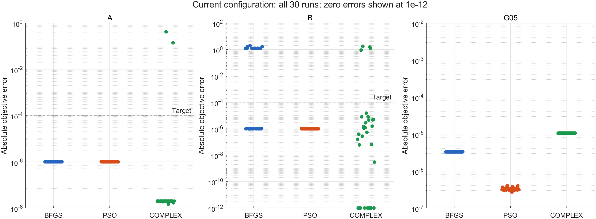
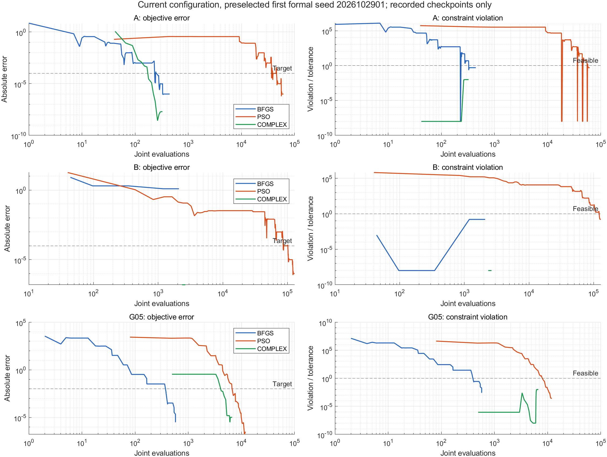
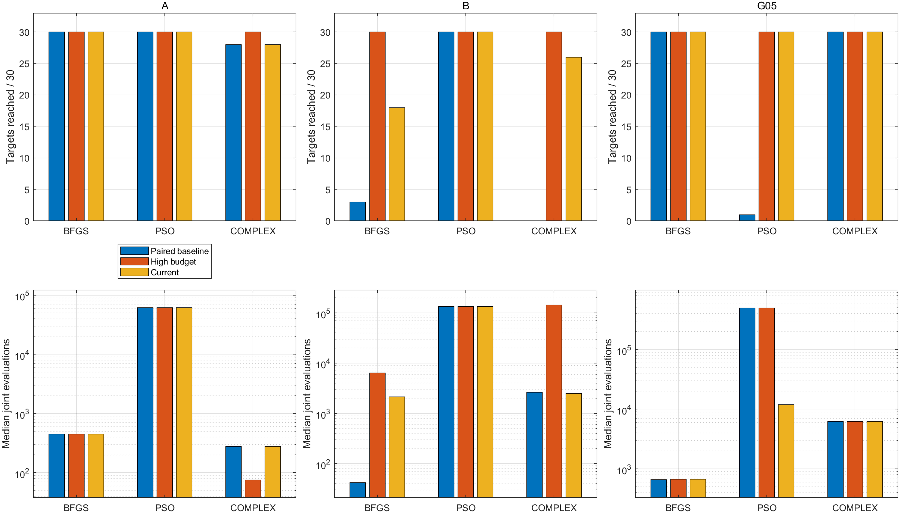
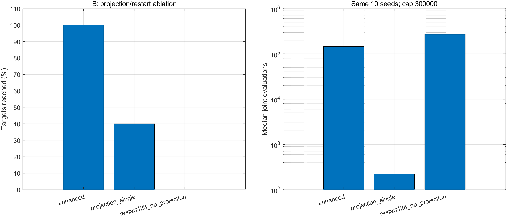

# 非线性约束优化三种求解方案的比较

本项目采用 [MIT许可证](LICENSE)，版权署名为 hyzf12321，2026年。外部参考资料的权利归其各自权利人所有。

使用 MATLAB 比较外罚函数法＋BFGS、外罚函数法＋粒子群优化（PSO）及复合形方案。三个问题依次考察基础非线性不等式约束、六维非凸多峰搜索，以及带非线性等式的混合约束。

两种外罚方案共用约束处理框架，比较不同搜索方法；复合形方案提供直接约束搜索的对照。比较对象是包含预处理、重启和恢复步骤的完整方案。代码、实验数据和图表公开，课程报告及个人信息不包含在此目录中。

当前配置每题每法30次，全部270个输出满足原约束；目标精度达标次数分别为：A题30/30、30/30、28/30，B题18/30、30/30、26/30，G05三法均30/30。未达标运行保留在数据及分析中。

## 文件与运行

```text
coursework_main.m                 模型、算法、实验、自检、统计和历史绘图
plot_public_results.m             重建本页四组公开图表
02_MATLAB验证/
  coursework_problem.m            独立模型与解析导数
  quadratic_penalty.m             独立二次罚函数实现
  verify_models.m                 独立模型/导数与fmincon交叉核查
03_验证结果/
  coursework_results.mat          从Release单独下载的完整结果库（不随Git提交）
figures/                          四组主要结果图
README.md
```

先下载或克隆代码，再到本仓库的 [Releases页面](https://github.com/hyzf12321/constrained-optimization-matlab/releases) 下载附件 `coursework_results.mat`。在仓库根目录创建 `03_验证结果` 文件夹，将MAT放进去；不要改变文件名。MAT校验值见下文“公开包核查”。

已使用 MATLAB R2023b。核心算法自行实现，不调用 `fmincon`、`fminunc` 或 `particleswarm`，不需要 Optimization Toolbox；只有可选的独立脚本 `verify_models` 使用该工具箱。保留中文目录和文件相对位置，在仓库根目录运行：

```matlab
coursework_main('summary_cost');      % 当前推荐配置，直接读取已有结果
plot_public_results;                  % 重建四组PNG，不重新优化、不改MAT
tests = coursework_main('selftest');  % 模型、算法、预算、坐标变换等60项自检
assert(all([tests.Passed]));

% 可选：读取历史阶段，均不重新求解
coursework_main('summary3');          % 原始370组正式/补充实验
coursework_main('summary_improved');  % 高预算改进及配对对照

% 可选：独立交叉核查，需要Optimization Toolbox，会产生核查输出
addpath('02_MATLAB验证');
verify_models;
```

主程序不带参数时会运行早期 `round1` 诊断并写入数据，因此查看结果时务必显式指定模式。`round1`、`round2`、`complex` 等历史实验入口也会写数据，使用前建议另存工作副本。`round3`、`improve`、`cost_review` 对已完成批次直接返回已有结果，不能把再次调用它们当成重新执行全套实验。需要研究新的参数或种子时，应在独立工作副本中调整协议并重新运行，避免混入已有正式统计。

旧绘图入口 `plot3`、`plot_improved`、`plot_cost` 保留，输出目录沿用 `90_临时文件`；使用这些入口前可执行 `mkdir('90_临时文件')`。本页图片统一由 `plot_public_results` 输出到 `figures`，无需旧图片或报告文件。

结果库约248 MB，通过Release附件分发，不放入普通Git提交，也不使用Git LFS。下载代码ZIP或克隆仓库不会自动取得该数据文件，读取统计与绘图前须先下载附件。`.gitignore`已排除MAT、报告与临时诊断文件。见 [GitHub大文件说明](https://docs.github.com/en/repositories/working-with-files/managing-large-files/about-large-files-on-github)。

## 问题模型与参考值

统一采用 $\min f(x)$，$g(x)\le0$，$h(x)=0$。代码内部用 `C` 表示G05。

### A：二维课内题

$$
\min_{u,v} f_A=(u-2)^2+v^2,\qquad -u\le0,\ -v\le0,\ u^2+v-1\le0.
$$

来源为课程“约束优化”中的K-T条件例题。可行性给出 $0\le u\le1$，因此 $(u-2)^2\ge1$、$v^2\ge0$，唯一全局解为 $(1,0)$，目标值1。计算边界为 $[-1,2]^2$，包含完整原可行域，不改变最优解。

### B：自建六维非凸耦合扩展

变量顺序为 $(u_1,v_1,u_2,v_2,u_3,v_3)$：

$$
\begin{aligned}
\min F={}&\sum_{i=1}^3\big[(u_i-2)^2+v_i^2+\sin^2(3\pi u_i)\big]\\
&+5\sum_{i=1}^2\big[(u_i-u_{i+1})^2+(v_i-v_{i+1})^2\big],
\end{aligned}
$$

每组约束均为 $-u_i\le0$、$-v_i\le0$、$u_i^2+v_i-1\le0$。计算边界为 $[-1,2]^6$。

三组基础目标分别至少为1，其余各项非负，因此全局参考值为3，唯一全局解为 $(1,0,1,0,1,0)$。正弦项引入非凸多峰性，耦合项连接各变量组。这是本项目自建问题，不是标准外部基准。局部KKT条件不保证达到这个全局参考值。

### G05：四变量混合约束基准

模型来自 CEC 2006 技术报告：

$$
\min f=3x_1+10^{-6}x_1^3+2x_2+\frac{2\times10^{-6}}3x_2^3.
$$

不等式为 $x_3-x_4-0.55\le0$、$x_4-x_3-0.55\le0$；等式为

$$
\begin{aligned}
1000\sin(-x_3-0.25)+1000\sin(-x_4-0.25)+894.8-x_1&=0,\\
1000\sin(x_3-0.25)+1000\sin(x_3-x_4-0.25)+894.8-x_2&=0,\\
1000\sin(x_4-0.25)+1000\sin(x_4-x_3-0.25)+1294.8&=0.
\end{aligned}
$$

边界为 $0\le x_1,x_2\le1200$、$-0.55\le x_3,x_4\le0.55$，角度采用弧度。严格等式数值参考目标为 `5126.49810959527`，参考向量约为 `[679.9453207360568;1026.0671316649825;0.1188763638621132;-0.396233553502708]`。它不是本项目给出的全局最优证明。

CEC容差带参考目标 `5126.4967140071` 对应允许等式残差的规则，不能和上述严格等式参考混用。参考点只用于核查与评价，不作为正式搜索的特殊初始点。

## 方法与实验配置

两种外罚方案使用同一变量归一化、尺度和罚函数：

$$
\phi=f/s_f+r\left[\sum_j\max(0,c_j)^2+\sum_k e_k^2\right],\quad
c=[g/s_g;-z;z-1],\quad e=h/s_h.
$$

目标尺度A/B/G05分别为1、3、10000；不等式尺度均为1，G05等式尺度为1000。11层罚系数从1至 $10^{10}$。G05另共同加入边界外四次保护项，避免三次目标在远处压过二次罚项；原边界内该项和梯度均为0。

- **外罚＋BFGS**：解析目标梯度与约束Jacobian，强Wolfe线搜索，`c1=1e-4`、`c2=0.9`。B题当前固定12起点，每起点最多7500次，总上限90000。
- **外罚＋PSO**：40粒子，惯性0.9至0.4，学习系数1.7；通过共同罚函数处理边界，无额外位置截断。G05当前总预算12000，实际11990次。
- **复合形方案**：反射、收缩、次坏点尝试。A题保留基本单起点配置；B题使用约束几何投影＋固定2起点，每起点最多2343次；G05使用只依据约束的等式恢复，目标优化仍由复合形搜索完成。

G05的两种外罚方案共用残差坐标预处理：原边界内搜索坐标为 $[z_3,h_1/1000,h_2/1000,h_3/1000]$，边界外有可逆的一阶连续延拓。四个变量仍独立搜索，三个等式仍由外罚处理，未固定为零。PSO没有引入梯度或BFGS精修。该处理利用G05结构，不代表一般PSO只靠调参数就获得同样效果。

共同最高允许评价预算A/B/G05分别为 `100000/300000/500000`；当前方案主动采用的较小上限单独披露。初始化、失败试探、全部重启、恢复及坐标转换的模型调用均计入联合评价。解析导数、差分Jacobian、投影标量迭代和耗时另外记录，单次模型调用的工作量并不完全相同。

### 种子与验收

当前正式种子固定为 `2026102901:2026102930`，同题方法间配对。开发、留出和正式结果分开统计，正式达标次数不用于选择配置。B题重启开发使用10个旧种子，在候选中选首个达到8/10的最小起点数；全新留出种子为 `2026102831:2026102835`。G05 PSO在5个开发种子上比较3000/6000/12000/24000预算，按预定门槛选12000，再做独立留出验证。

达标同时要求原始不等式违反量不超过 `1e-6`、边界违反量不超过 `1e-8`，G05原始等式残差不超过 `1e-4`，并满足目标绝对误差A/B不超过 `1e-4`、G05不超过 `1e-2`。G05额外统计 `1e-6` 等式严格诊断。这是本项目验收规则，不是CEC官方竞赛成绩。

## 当前结果与分析

下表均为30次运行的统计。目标误差相对上述原目标参考值计算，计时单位为秒。

| 问题 | 方法 | 达标次数 | 误差中位数 | 误差均值 | 最坏误差 | 联合评价中位数 | 求解耗时中位数 |
|---|---|---:|---:|---:|---:|---:|---:|
| A | 外罚＋BFGS | 30/30 | 1.00e-6 | 1.00e-6 | 1.00e-6 | 446 | 0.01810 |
| A | 外罚＋PSO | 30/30 | 1.00e-6 | 1.00e-6 | 1.00e-6 | 61415 | 0.92270 |
| A | 复合形 | 28/30 | 1.98e-8 | 0.01865 | 0.41903 | 279 | 0.004758 |
| B | 外罚＋BFGS，12起点 | 18/30 | 1.00e-6 | 0.54637 | 1.9922 | 2140.5 | 0.11469 |
| B | 外罚＋PSO | 30/30 | 1.00e-6 | 1.00e-6 | 1.00e-6 | 134112 | 2.44520 |
| B | 投影复合形，2起点 | 26/30 | 8.30e-7 | 0.17966 | 1.7292 | 2518.5 | 0.06471 |
| G05 | 外罚＋BFGS，残差坐标 | 30/30 | 3.30e-6 | 3.30e-6 | 3.30e-6 | 665.5 | 0.02415 |
| G05 | 外罚＋PSO，残差坐标 | 30/30 | 3.28e-7 | 3.30e-7 | 4.03e-7 | 11990 | 0.24176 |
| G05 | 复合形＋等式恢复 | 30/30 | 1.06e-5 | 1.06e-5 | 1.06e-5 | 6246.5 | 0.09313 |

九组合可行次数均为30/30，G05也全部通过额外严格等式诊断。中位误差不能掩盖未达标运行：B题BFGS有12次未达全局参考精度，复合形有4次，A题复合形有2次。这些输出满足约束，却不满足目标精度。

完整标准差、四分位距、最好/最坏值、导数和辅助处理成本见 `cost_review.summary_all`，逐次输出见 `cost_review.table_all`。允许微小约束违反时目标值可略低于严格参考值，不能据此声称超过数学最优值。

多起点耗时为实测子求解器耗时之和；B题当前配置由已保存的固定重启前缀得到，包装层时间没有重新测量，`wall_seconds=NaN`。不能将其写成独立测得的端到端时间。耗时依赖运行机器，复现时重点核对数值、种子和评价次数。

### 四组主要图表



全部30次结果均展示，图中的零误差仅为对数显示截为 `1e-12`，不修改数据。A题复合形成本低但有未达标结果；B题PSO本批全部达标，评价成本较高。



统一采用正式列表中的第一个种子 `2026102901`，用于说明目标改善与可行性演进，不作为30次平均表现。仅连接已保存检查点，不补造首次评价之前的值；曲线可含不可行试探点，违反量除以各自原始验收容差，横轴是累计联合评价次数。未标出的两个检查点之间不能推断精确首次达标成本。



原始370组实验的PSO-G05为2/30；图中同新种子的配对原方案为1/30，两者不能混用。残差坐标使同种子高预算PSO由1/30提高至30/30；当前低预算配置仍为30/30，评价中位数由499994降至11990。B题BFGS从单起点3/30、40起点30/30，折中为12起点18/30；投影复合形从高预算128起点30/30折中为2起点26/30。图中没有单独配对原方案的组合沿用未改变的方案作为基线，不能将这些柱子解读为新增实验。



使用已有同10种子消融数据。`enhanced` 为投影＋128起点，`projection_single` 为投影＋单起点，`restart128_no_projection` 为无投影＋128起点；总最高预算30万。该图属于高预算机制对照，不是当前2起点配置的成功率。几何投影与重启的效果应分别分析，投影不使用优化目标或参考最优点。

总体上，BFGS在可利用导数与结构的配置中评价成本低，但B题全局覆盖受初始点影响；PSO在当前B题设置下覆盖稳定，模型调用更多；复合形不需目标导数，基础开销低，可行性恢复和几何投影使其适配更多约束结构，但点集收缩或反射停滞不等于全局最优。30/30只描述已测试批次，不保证任意种子成功。新版G05没有完整重做罚系数敏感性扫描，不能将旧坐标的敏感性结论套用于新版。

## 数据组织与公开副本

MAT顶层变量为 `coursework_results`，保留 `round1/round2/complex_addition/quality_review/round3/improvement/cost_review/delivery_review` 等阶段，不删除历史失败数据。

```matlab
s = load('03_验证结果/coursework_results.mat','coursework_results');
d = s.coursework_results;
b = d.improvement.batches{d.improvement.latest};
current_runs = [b.experiments(d.cost_review.existing_indices); d.cost_review.runs];
disp(d.cost_review.summary_all);  % 9行组合统计
disp(d.cost_review.table_all);    % 270行逐次结果
assert(numel(current_runs) == 270);
```

原第三轮保留270组主实验、60组多起点及40组敏感性补充。高预算改进另有440组验证/对照；当前配置的180组引用既有记录、B题60组采用固定重启前缀、G05新增30次低预算求解，不能将引用视为新的独立重复试验。

部分子运行轨迹为无损列式存储，带 `trace_storage='columns-v1'`、`trace_shapes` 和 `trace_size`；例如 `r.trace.evaluations`、`r.trace.f` 为按检查点拼接的字段矩阵。主程序自带解码，新绘图脚本兼容列式及逐点结构体格式。早期第一轮两个诊断批次的末端成本轨迹不完整，保留为历史，不用于正式成本分析。

公开副本仅将历史文本元数据中的本机项目绝对路径替换为相对路径；数值、种子、算法参数、统计、输出、轨迹、退出状态和未达标记录保持不变。历史快照用于追溯当时版本，不替代当前代码。报告、封面、课件全文、参考论文PDF及本地历史ZIP未包含在公开文件中。

## 公开包核查

整理日期：2026-11-03。4个既有MATLAB文件与原文件逐一SHA-256一致；新增的绘图脚本及4个既有文件均通过Code Analyzer检查。已在本目录实际通过60项自检，读取当前和历史汇总，并从公开MAT重建、查看四组图片。

当前270个输出再次用独立模型计算原目标和约束，最大差异为0，逐次目标、评价次数及达标标记与保存表格一致，全部满足原始可行性标准。公开MAT保存后重载并以 `isequaln` 验证一致。此次未重跑整套正式实验或可选的 `verify_models` 全流程。

公开MAT共247877748字节，SHA-256为：

```text
37f9f8ee4eb481a609593cf92623e475b9358f2df450e8e8659d6d56bec50699
```

## 参考来源

- 课程讲义：约束优化中的K-T例题、外罚函数法、复合形法，无约束优化中的BFGS，以及Wolfe线搜索。课件全文不随仓库分发；A题原模型已在本页完整给出。
- Liang J J, Runarsson T P, Mezura-Montes E, et al. *Problem Definitions and Evaluation Criteria for the CEC 2006 Special Session on Constrained Real-Parameter Optimization*. 2006. [技术报告](https://al-roomi.org/multimedia/CEC_Database/CEC2006/CEC2006_TechnicalReport.pdf)：G05模型与评价背景。
- Kennedy J, Eberhart R. *Particle Swarm Optimization*. 1995. [原论文](https://staff.washington.edu/paymana/swarm/kennedy95-ijcnn.pdf)：PSO基本更新思想。另见 [MathWorks算法说明](https://www.mathworks.com/help/gads/particle-swarm-optimization-algorithm.html)。
- Runarsson T P, Yao X. *Stochastic Ranking for Constrained Evolutionary Optimization*. IEEE Transactions on Evolutionary Computation, 2000, 4(3): 284–294. [DOI](https://doi.org/10.1109/4235.873238)：等式容差与目标参考值解释；本项目没有实现随机排序算法。
- Spettel P, Ba Z, Arnold D V. *Active Sets for Explicitly Constrained Evolutionary Optimization*. Evolutionary Computation, 2022, 30(4): 531–553. [DOI](https://doi.org/10.1162/evco_a_00311)：严格等式数值参考的补充来源；独立求解的一致性不构成全局最优证明。

